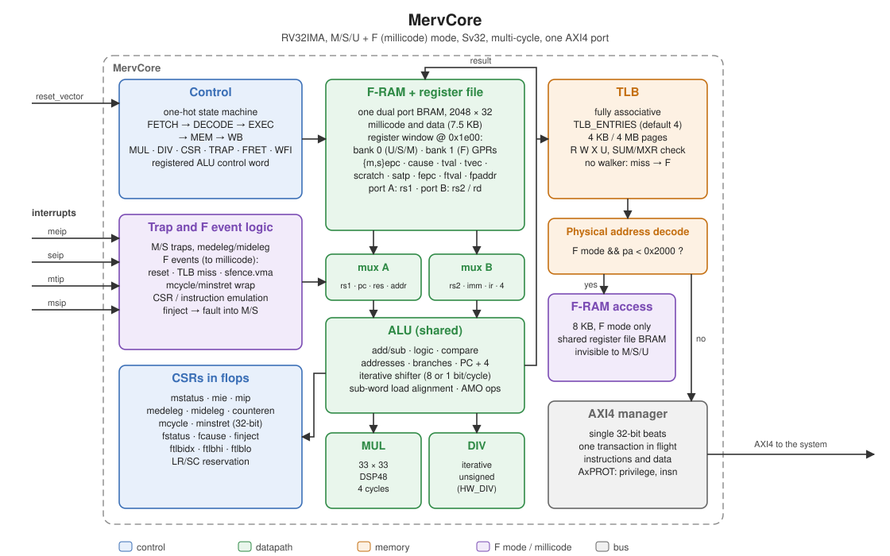
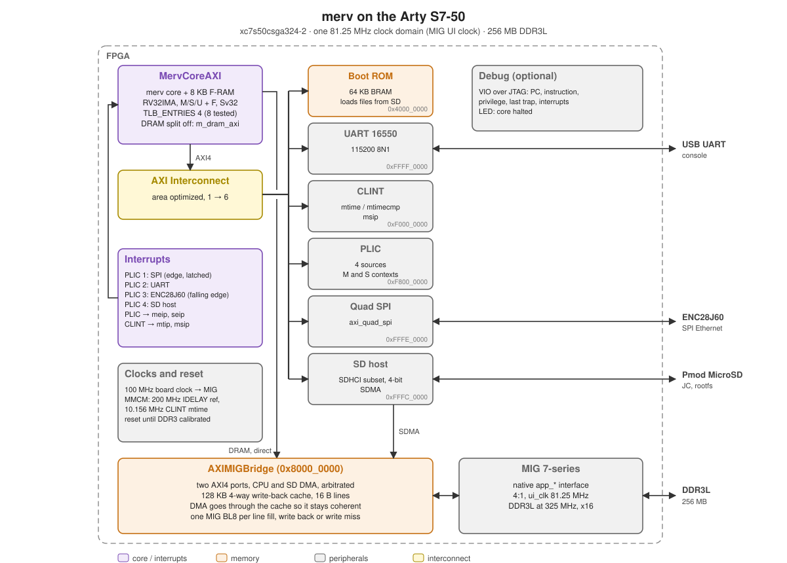

# merv

merv (Millicode Enhanced RISC-V) is a small RV32IMA RISC-V core (M, S and U
modes, Sv32) for Spartan-7 FPGAs that trades IPC for Fmax and a low LUT
count.  It runs the generic
OpenSBI platform and an unmodified rv32 Linux kernel.

The minimal configuration of merv can boot an unmodified Linux kernel and Yocto
user-space with the core only using ~1310 LUTs on a Spartan 7 device.

Features that are rare or expensive in hardware are implemented in
millicode: RISC-V firmware running in **F mode**, a non-standard privilege
level above M mode that is invisible to it:

- **No hardware page table walker**: a small fully associative TLB (4 entries
  by default) is filled by the F mode firmware on a miss, including Svade
  style accessed/dirty handling and faults injected back into the trapping
  privilege level.
- **32-bit counters**: `mcycle`/`minstret` wraps trap to F mode which
  maintains the upper halves.
- **CSR emulation**: only the frequently used CSRs are implemented in
  hardware, everything else (`misa`, the ID registers, PMP, HPM counters,
  `time`, `*envcfg`, triggers...) is emulated.
- **Optional AMO, multiplication and division emulation** (`NATIVE_AMO=0`,
  `HW_MUL=0`, `HW_DIV=0`) and signed division with negative operands is
  always emulated.  An optional single cycle barrel shifter
  (`BARREL_SHIFT=1`) replaces the iterative one.

The F mode firmware lives in a private 8KB RAM, has its own GPR bank and its
CSRs are inaccessible to M mode.  The GPRs are mapped into the top of the
F-RAM so the firmware reads and writes the trapping code's registers with
loads and stores.  See [docs/merv-arch.md](docs/merv-arch.md)
for the architecture specification.

## Microarchitecture



- Multi-cycle state machine (one-hot), every state boundary registered and
  the ALU control registered from the next state.
- One ALU shared by everything: arithmetic, address generation, branch/jump
  targets, PC increment, AMOs and moving values between registers.  Shifts
  are iterative (8 or 1 bits per cycle) or, with `BARREL_SHIFT=1`, single
  cycle, sub-word loads are aligned by the shifter.
- The F-RAM, both GPR banks and the CSRs that are only accessed by software
  or on traps share a single dual port block RAM read with the output
  register: the registers are the top 512 bytes of the F-RAM so the firmware
  accesses the trapping code's registers with ordinary loads and stores.
- Multiplier on DSP48s, iterative unsigned divider.
- Single AXI4 manager port for instructions and data with one transaction in
  flight, no caches.

## Results

Vivado 2025.2, xc7s50csga324-2:

| Build                                  | LUTs | FFs  | BRAM36 | DSP | Timing                      |
| -------------------------------------- | ---- | ---- | ------ | --- | --------------------------- |
| Core out of context (`fpga/ooc`)       | 1420 | 1081 | 2      | 4   | 191 MHz (WNS -0.23ns @ 5ns) |
| Core out of context, TLB 8, barrel     | 1598 | 1261 | 2      | 4   | 193 MHz (WNS -0.19ns @ 5ns) |
| Core in the Arty system (TLB 8, barrel) | 1544 | 1354 | 2     | 4   | met @ 81.25MHz (WNS +0.86ns) |
| Arty system total (incl. MIG, SD, SPI) | 11303 | 10326 | 56   | 4   | met @ 81.25MHz (WNS +0.73ns) |
| Arty system, 4 harts (TLB 8, barrel)   | 17488 | 14517 | 62   | 16  | met @ 81.25MHz (WNS +0.74ns) |
| 4 harts, cores at 2x (162.5MHz)        | 17530 | 15125 | 62   | 16  | met @ 162.5MHz (WNS +0.002ns) |

The divider and the shifter, out of context with the default `TLB_ENTRIES=4`
and `NATIVE_AMO=1`, and the cycles to boot Linux to a hello world init in
lockstep RTL simulation (`merv-sim --cosim --hw-div N --barrel-shift N`):

| HW_DIV | BARREL_SHIFT | LUTs | FFs  | Fmax    | Boot cycles   |
| ------ | ------------ | ---- | ---- | ------- | ------------- |
| 1      | 0            | 1420 | 1081 | 191 MHz | 765M          |
| 1      | 1            | 1472 | 1074 | 202 MHz | 750M (-2.0%)  |
| 0      | 0            | 1310 | 1015 | 195 MHz | 776M (+1.5%)  |
| 0      | 1            | 1371 | 1011 | 196 MHz | 761M (-0.5%)  |

The barrel shifter costs 50-60 LUTs for 2% fewer cycles, emulating division
saves 110 LUTs for 1.5% more.  The Fmax differences are within the run to run
variation of placement at a 5ns target.

The core's critical path is the ALU operand select through the ALU's full
carry chain into an F mode CSR write.  The FF counts vary by tens between
runs with Vivado's register replication.  In the Arty system the interconnect
is an area optimized AXI Interconnect (898 LUTs, a SmartConnect was 5948
LUTs), the DDR3 bridge with its cache 1112 LUTs and 36 BRAM36 and the PLIC
155 LUTs.

Configuration sweep of the core alone from Yosys `synth_xilinx` with a rough,
deliberately pessimistic, timing model (`fpga/ooc/yosys-estimate.sh`), useful
for relative comparisons:

| TLB | NATIVE_AMO | HW_DIV | LUTs | FFs  | Fmax (est.) |
| --- | ---------- | ------ | ---- | ---- | ----------- |
| 4   | 1          | 1      | 1715 | 1117 | 150 MHz     |
| 4   | 0          | 1      | 1745 | 1117 | 139 MHz     |
| 4   | 1          | 0      | 1572 | 1045 | 145 MHz     |
| 2   | 1          | 1      | 1639 | 1023 | 141 MHz     |
| 8   | 1          | 1      | 1828 | 1305 | 139 MHz     |
| 16  | 1          | 1      | 2102 | 1681 | 139 MHz     |

Native AMOs are both smaller and faster than emulating them in F mode (the
AMO reuses the ALU, emulation needs extra state to pass the physical address)
so `NATIVE_AMO=1` is the default.

Instructions executed to boot Linux to a hello world init on the ISS:

| Configuration    | Total  | F mode | TLB misses |
| ---------------- | ------ | ------ | ---------- |
| TLB 2            | 75M    | 42M    | 2.4M       |
| TLB 4 (default)  | 53M    | 21M    | 1.1M       |
| TLB 8            | 41M    | 9M     | 0.35M      |
| TLB 16           | 39M    | 7M     | 0.20M      |
| TLB 4, HW_DIV=0  | 54M    | 22M    | 1.1M       |

The RTL averages ~13 cycles per instruction with a 2 cycle memory latency
(0.77G cycles to boot Linux in simulation).  `TLB_ENTRIES=8` executes ~22%
fewer instructions for ~110 LUTs and is worth considering where performance
matters.

## Layout

```
docs/merv-arch.md     architecture specification (ISS, firmware and RTL)
sim/                  instruction set simulator, RTL simulation and lockstep co-simulation
firmware/ffw/         F mode firmware
rtl/                  the core (SystemVerilog)
tests/asm/            directed tests (F mode isolation, counters, CSR emulation, Sv32)
verif/                riscv-tests/riscv-arch-test integration, RTL unit tests
platform/             device trees, Linux configuration, hello world initramfs
scripts/              test runners, software build scripts
fpga/ooc/             out-of-context synthesis (Vivado and Yosys estimate)
fpga/xilinx/          Arty S7-50 system (block design, DDR3 bridge, boot ROM)
fpga/common/          peripherals (SD host, PLIC, CLINT) and boot ROM sources
```

## Building and testing

Requirements: CMake >= 3.20, Ninja, a C++20 compiler, Verilator 5,
`riscv64-unknown-elf-` and `riscv64-linux-gnu-` toolchains, Python 3, dtc and
the newlib headers (`/usr/include/newlib`) for riscv-tests.

    git submodule update --init --recursive
    cmake -S . -B _build -GNinja
    ninja -C _build
    ctest --test-dir _build -j$(nproc)

This runs, for the ISS in four configurations and the RTL (lockstep against
the ISS) in two:

- riscv-tests rv32ui/um/ua/si/mi, physical and virtual memory variants,
- riscv-arch-test 2.6.2 I, M, Zifencei and privilege,
- the directed F mode tests,
- the DDR3 bridge (arbitration, exclusive monitors) and CLINT unit tests,
- an SMP atomics test on the ISS with 4 harts,
- Linux boots on the ISS, single hart and SMP with 4 harts (if the software
  has been built).

The `rtl-excl` configuration builds the core with `AXI_EXCLUSIVE=1` (as for
SMP) and fails the first exclusive write of every AMO (`--amo-retry`) to
exercise the core's retry.

### Software

    scripts/build-software.sh          # OpenSBI v1.6, Linux, initramfs, DTB into _build/sw

Linux is built from a shared clone of `~/src/linux` (`LINUX_REPO`) at v6.9
(`LINUX_VERSION`) so the source tree isn't modified.

### Simulation

    _build/sim/merv-sim --elf _build/sim/bootrom/sim-bootrom.elf $(cat _build/sw/boot-args)

boots OpenSBI and Linux on the ISS (~10s), printing "Hello, world" from the
initramfs before powering off.  `$(cat _build/sw/boot-args-smp4)` boots an SMP
kernel on 4 harts (`--harts 4`, ISS only).  `--rtl` simulates the Verilated RTL instead,
`--cosim` simulates the RTL checked instruction by instruction against the
ISS (~10 minutes for the Linux boot).  `--help` lists the other options
(tracing, waveforms, configuration).

## FPGA



The Arty S7-50 system has `MERV_NUM_HARTS` (1-4, default 4) cores, a 16550
UART, PLIC, CLINT, the SD host controller (SDMA into DRAM), Quad SPI with the
ENC28J60 and the DDR3 through a MIG native interface bridge, all in the
81.25MHz MIG UI clock domain.  The bridge has a 128KB 4-way set associative
write-back cache (16 byte lines, no write allocate) that the cores and the SD
DMA all go through, so DMA and the harts are coherent without any cache
maintenance.  It arbitrates its ports round robin a transaction at a time and
has an exclusive monitor per port for the atomics.  With no caches in the
cores every instruction fetch goes to the bridge, which limits scaling: it
saturates at around 4-5 harts.  The boot ROM runs on hart 0, the other harts
wait for their CLINT `msip` and then enter OpenSBI.  The cores' DRAM accesses are split off in
`MervCoreAXI` and go straight to the bridge rather than through the
interconnect, so an instruction fetch or load that hits in the cache takes 4
cycles from the fetch/translate state to the data (6 with the core's TLB
lookup).  Writes are posted: the bridge takes the data with the address and
responds straight away.

    scripts/build-arty-sdcard.sh       # OPENSBI.BIN, IMAGE[GZ].BIN, MERV.DTB ($MERV_NUM_HARTS harts)
    mkdir -p _build/vivado && cd _build/vivado
    vivado -mode batch -source ../../fpga/xilinx/merv-arty.tcl
    vivado -mode tcl -source ../../fpga/xilinx/program.tcl

With `MERV_CORE_CLK2X=1` the cores run at 162.5MHz, twice the UI clock and
phase aligned with it (from the MMCM in `fpga/xilinx/Top.v`), with the rest
of the system at 81.25MHz.  `MervAXIClk2x` crosses each core's AXI manager
into the UI clock domain through registers on both sides, so the paths
between the domains are timed as one fast cycle without exceptions.  The
DRAM accesses take about 2.5 more fast cycles than at 1x, but with 4 harts
Linux reaches the login prompt about 1.7x sooner (16s rather than 33s to
init) and a 4 thread atomics stress test runs 1.6x faster.  The cores only
just close timing at 162.5MHz (their critical path is the ALU into the
register file BRAM).

The boot ROM loads the files from a FAT16 first partition of the SD card
(Pmod MicroSD in JC) with the root filesystem on the second partition.  It
loads the uncompressed kernel `IMAGE.BIN` if present, otherwise it
decompresses `IMAGEGZ.BIN`, which is much slower on the core.

**Status**: boots OpenSBI, Linux 7.3-rc6 and a systemd root filesystem from the
SD card to a login prompt (with `TLB_ENTRIES=8` and `BARREL_SHIFT=1`,
`MERV_TLB_ENTRIES=8 MERV_BARREL_SHIFT=1` when building), about 8 minutes
after programming the FPGA.  The core is slow enough that systemd needs a
longer unit start timeout, which `platform/merv-arty.dts` sets on the kernel
command line along with masking the network services.

## Acknowledgements

merv was generated with Claude Opus.  It borrows the platform, peripherals
(SD host controller, PLIC, CLINT), boot ROM, tooling and build infrastructure
from the [rxv](https://github.com/jamieiles/rxv) project.

## License

Licensed under the Apache License, Version 2.0, see [LICENSE](LICENSE).
